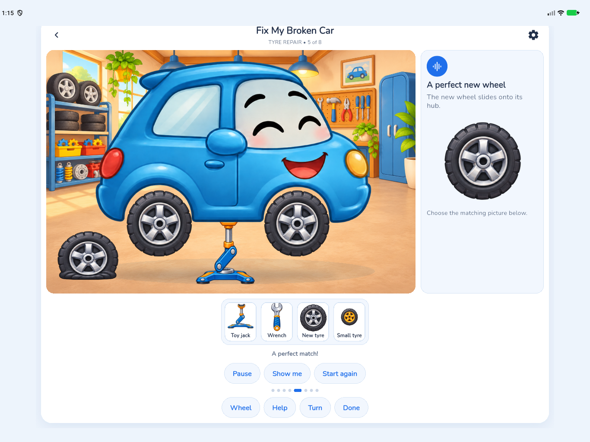
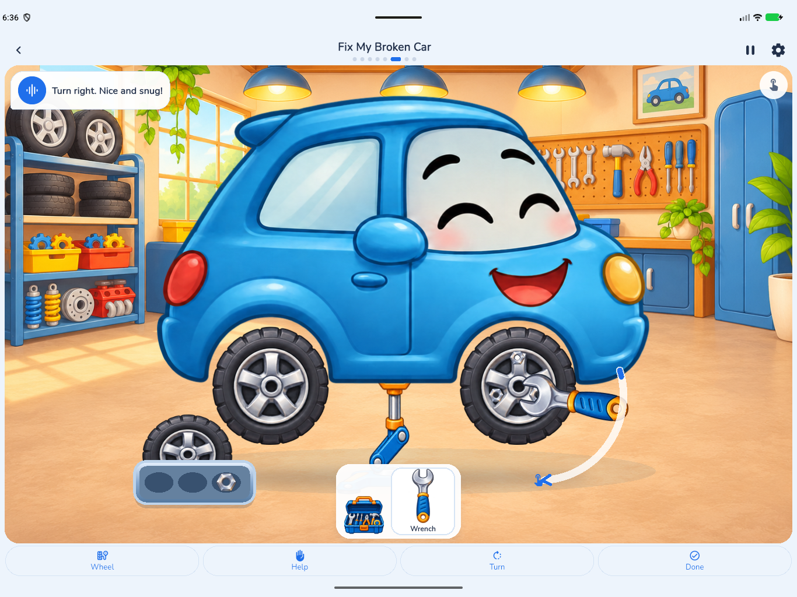

# Fix My Broken Car — immersive tyre preview v4

This continues the existing isolated Flutter preview. The car, garage, eight pose images, tool illustrations and rig are preserved. No production integration or later mission work has been performed.

## Inspect the change

| Before | Enhanced preview |
|---|---|
| [Android landscape](before-landscape.png) | [Installed Android landscape](native-wrench-tighten-landscape.png) |
| [Previous Android recording](before-gameplay.mp4) | [New repair recording](gameplay-android-final.mp4) · [Finish clip](gameplay-android-finish.mp4) |
| [Original phone](../tyre_preview_v3/screenshots/390x844-garage.png) | [Installed Android phone](native-nut-portrait.png) |

Before:

After:

[Portrait completion](native-completion-portrait.png) · [Phone garage](native-garage-portrait.png) · [Nut removal in motion](screenshots/nut-removal-flight.png) · [Exposed hub](native-hub-exposed-landscape.png) · [Completion](native-completion-landscape.png)

[Inspection report](INSPECTION.md) identifies the actual prior UI and interaction problems and responsible files. All screenshots are actual Flutter rendering, not design mockups. The `native-*` images are installed Android captures; `screenshots/` images are widget-rendered at the stated logical sizes. Widget exports use Arial for deterministic text rendering; the Android app uses its existing theme typography.

## Implemented

- The garage occupies the main screen. A single short speech bubble replaces the fixed narration column, repeated feedback text and duplicate game-action buttons.
- Direct wheel inspection, jack release and wrench manipulation remain scene actions. Navigation, pause and settings are in the header. Narration and hints sit with the scene; picture AAC responses have a separate, always accessible footer. Restart is in settings.
- The illustrated toolbox opens/collapses a task-specific dock. Selected tools lift; drags cast a shadow; invalid drops animate back. Unrelated tools are unavailable rather than competing for attention.
- Camera movement and all scene hitboxes use the same `GarageCamera` transform. The camera moves gently closer during repair and returns on completion. Motion can be reduced.
- Unfinished nuts are individually selectable. The wheel accepts a forgiving wrench drop and resolves the nearest unfinished nut using the actual finger position. This fixes the small-screen bug caused by using the feedback image's top-left offset.
- The turning guide shows direction and progress. Pointer tracking avoids competing drag recognizers; cancellation, multi-pointer guarding, dead-zone handling and an assisted turn action are included.
- Coalesced Android pointer updates just over 90 degrees are accepted rather than discarded. Decorative painting no longer invalidates the accessibility tree on each frame.
- Completed nuts visibly spin and travel into a parts tray. A guarded settling phase prevents duplicate nuts or overlapping completions. Nut three automatically advances after its feedback animation.
- Jack handle motion accompanies the coordinated lift. The old wheel can be dragged away; the exposed hub remains; correct replacement snaps into place. Tightening and lowering are required before celebration.
- Existing face poses respond to repair state; the car smiles after progress, blinks, and celebrates completion. The optional completion-only “Drive out” reward rotates the wheels and moves the car out while the jack remains on the garage floor.
- Leaving and reopening the preview retains repair state and motion progress in memory, paused for explicit resume. Process termination does not persist this temporary preview session.

## Reused components and changed files

Reuses `AppTheme`, `AppColors`, `PageDots`, `RoundIconButton`, `PillButton`, `SpeakerBadge`, `Narrator`, `AppSettings`, native `TyreSound`, Flutter controllers and the measured illustrated rig. No dependency or art asset was added.

- `lib/preview/tyre/tyre_screen.dart`: adaptive garage UI, dock, contextual bubble, AAC, camera-aligned targets, gestures, animation and lifecycle coordination.
- `lib/preview/tyre/tyre_game.dart`: individual nut selection, completed-nut sets, guarded settling, available tools and in-memory route continuity.
- `lib/preview/tyre/tyre_art.dart`: shared camera geometry, parts tray, nut flight, jack handle, car reactions and victory departure.
- `lib/preview/tyre_preview_main.dart`: preserves the temporary session across preview route visits and scrolls the launch card on short landscape screens.
- `test/tyre_slice_test.dart`: full physical repair, state guards, phone pointer accuracy, orientation, cancellation, route continuity, accessibility/layout checks and screenshot capture.
- `tools/build_tyre_preview_v4.ps1`, `tools/verify_tyre_preview_v4_android.py`: isolated APK build and native gesture walkthrough.

## Verification and limitations

- Full regression suite: **86 passed**, including fourteen tyre tests. [Test log](tests.log).
- Analyzer: **No issues found**. [Analyzer log](analyze.log).
- Final Android build succeeded in 39.0 seconds. [Build log](build.log).
- [APK](../../dist/fix-my-broken-car-tyre-preview-v4.apk): package `com.socialstories.social_stories.carpreview`, version `1.0.0-tyre.4`, version code 4. SHA-256: `079F555420FDD676CBE7B9B00064E4B9855A029807CAEB0DD5A0ED589EC9FA48`. Size: 410,042,610 bytes.
- All eight approved artwork/rig files in the APK match the workspace byte for byte, and its Dart kernel matches the final build output. [Package verification](package-verification.json).
- Tests cover actual drags, both turn directions, out-of-order nut selection, coalesced turns, animation pause/resume, interrupted/cancelled gestures, wrong-size rejection, route continuity, replay and victory departure. Six phone/tablet sizes include large text and reduced motion.
- The complete installed tablet walkthrough passed with real gestures: inspect, invalid jack placement and return, lift, three left turns, automatic third-nut transition, remove damaged tyre, reject the small tyre, fit the correct tyre, three right turns, lower, celebrate and drive out. [Native interaction log](native-interactions.log).
- Native portrait checks passed: retained completed session, replay, jack drag/lift, intentional selection of nut three and its turning gesture at phone density. [Phone log](native-phone.log).
- A partially repaired phone session also retained its nut inventory after leaving and reopening. [Resume log](native-resume.log).
- The short landscape launch card was checked at 800×360: scrolling reveals the complete 48-pixel Enter target. [Launcher capture](native-launcher-phone-landscape.png), [launcher log](native-launcher.log).
- The installed APK's SHA-256 matches the downloadable APK exactly. [Installed package verification](installed-apk-verification.json).
- Active debug-phone memory snapshot: total PSS 241,254 KB, RSS 281,612 KB, swap PSS 82,588 KB. This is a single emulator observation, not a release memory budget or leak assessment. [Memory snapshot](native-memory.txt). The retained final process log contains no `E/flutter`, fatal Java exception or unhandled exception. [Runtime log](native-runtime.log).
- The two raw clips decode correctly. The main capture reaches Android's three-minute limit during tightening; the finish clip resumes on the final tightening turn and includes lowering and departure. They are separate captures, not represented as a single uninterrupted recording. The complete live sequence was exercised and logged. [Video verification](video-verification.json).

The initial emulator run encountered Android's own “System UI isn't responding” dialog. The test emulator was restarted without clearing its data. This environment issue and slow cold-start captures are retained as diagnostics, not presented as passing gameplay evidence. No physical-device frame-rate target is claimed.

The approved imagery is preserved; its raster expression poses are used rather than claiming independent skeletal eyebrow/mouth animation. The cabinet and door are baked into the garage illustration and have not been presented as separately animated objects. Toolbox interaction and subtle scene lighting provide the added environment response.

This is a debug preview containing the app's bundled assets, not an optimized store package. Emulator captures do not establish physical-device performance, and no iOS run or real-device listening check is claimed. Screen recordings are silent; installed narration and sound should be reviewed on the device. An independently accessible original Figma document was unavailable, so existing app code, palette, widgets and approved artwork are the design baseline.

## Approval boundary

Please approve this tyre-only interaction and UI preview, or identify the adjustments you want. Production integration, engine repair, wash, customization and the full test-drive mission remain pending approval.
